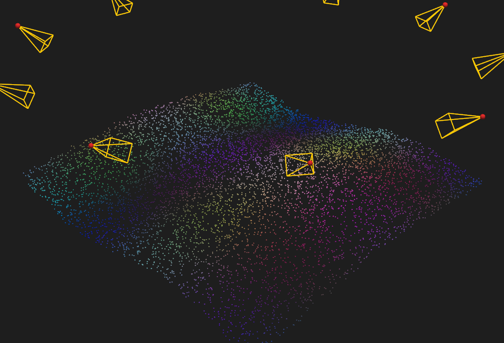

# CloudLabeller

[](https://doi.org/10.5281/zenodo.21393023)

**CloudLabeller streamlines object annotation in 3D point clouds.** It takes
you from a folder of photos to a dense, fully labelled point cloud in one
desktop app: reconstruct the scene photogrammetrically, label a handful of
images — or paint the cloud directly — and let camera projection and a U-Net
propagate the labels to everything else.



Manually classifying millions of points is the bottleneck of every
photogrammetric mapping workflow. CloudLabeller attacks it from both sides:
labels drawn on **2D images** are projected onto the **3D cloud**
(visibility-aware voting across views), labels on the cloud are projected
back onto every image, and a U-Net trained on the few images you touched
predicts the rest. Built for geological outcrop mapping, but suited to any
survey where per-point classes matter.

## Features

**Surveys**
- A Project holds one site's **Surveys**: each acquisition (a flight, a
  field day) with its own photos, camera and settings, its name, time,
  operator and notes. Labels and the U-Net are shared across them.
- Running a step again keeps the earlier result: each Survey keeps its
  **Reconstructions**, sharing what they have in common; choose the one
  shown, copy labels between them, delete the ones you don't need.
- **GCPs**: import surveyed coordinates (any projected CRS or WGS 84, with
  ellipsoidal or sea-level heights), mark them on the photos or on the
  cloud (a click snaps to the nearest point), and align every Survey to
  them, or to each other through GCPs they share. Residuals per GCP and
  Survey, check points, and hints showing where each GCP should be in a
  photo.

**Photogrammetry** (COLMAP / pycolmap)
- Structure-from-Motion with spatial (GPS), sequential or exhaustive
  matching; GPU SIFT + matching via CUDA COLMAP, with automatic CPU fallback.
- Dense multi-view stereo with resolution presets, a fast *Draft* quality
  mode, and crash-resumable workspaces.
- Meshing: Poisson (depth auto-matched to the cloud's density, with run-time
  and RAM estimates) or Delaunay, rebuilt automatically after MVS.
- Georeferencing to the images' EXIF GPS (metric, true-north local frame) —
  automatically after SfM (optional) or on demand, with outlier-robust
  fitting; runs natively, no COLMAP executable needed.
- Reproject the whole project (clouds, mesh, cameras) into any projected
  CRS — coordinates are stored minus a km-rounded offset to preserve
  precision, the current frame shows in the status bar, and camera positions
  appear next to the file names in the Dataset pane. Georeferencing and
  reprojecting store a transform; no product file is ever rewritten.
- A one-click **full pipeline** (SfM → MVS → mesh) for overnight runs — the
  machine is kept awake and every stage logs to the project.
- COLMAP is **not** bundled: *Photogrammetry → Download COLMAP…* fetches the
  official release on demand (CUDA or CPU-only, auto-detected).

**Labelling**
- Draw polygon labels on images or select points/faces on the cloud and mesh
  with a shared class schema (colours, hotkeys) and full undo/redo.
- Bidirectional transfer: *Images → Cloud* (multi-view voting) and
  *Cloud → Images* (per-pixel masks), both visibility-aware.
- An image-overlap (covisibility) graph from the SfM solve keeps every
  transfer restricted to the images that actually see the labelled area.
- Per-image status dots show label provenance at a glance: user-drawn,
  projected/predicted, or unlabelled.

**Machine learning**
- Train a U-Net on your labelled images (TensorFlow), predict the whole
  image store, and send the predictions to the cloud — label a few images,
  annotate the entire survey.
- The network works on overlapping **Tiles**, so one model covers Surveys
  taken with different cameras; predictions are blended seamlessly and
  show how unsure the model is, per pixel and per photo. Train on, and
  predict, any choice of Surveys.

**Data interchange**
- Export labelled clouds to `.las`, `.ply` or `.csv` and meshes to `.ply`,
  `.obj` or `.stl` for GIS and geomodelling tools.
- Georeferenced projects export in any projected CRS — searchable EPSG
  picker with the site's UTM zone pre-selected, optional sea-level (EGM96)
  heights. The CRS ships inside the LAS header and as a `.prj` sidecar for
  the other formats.
- Projects are plain folders — copy them between machines as-is.

## Getting started

**Install** (Windows 10/11, x64): download `CloudLabeller_<version>_x64-setup.exe`
from the [Releases](https://github.com/italo-goncalves/cloudlabeller/releases)
page and run it; no administrator rights are needed. On first start the app
sets up its Python Environment by itself, which downloads a few GB once:

- in WSL, on the GPU, when a WSL distro exists and `nvidia-smi` works there;
- otherwise natively on Windows, on the CPU.

Installed copies update themselves from new releases.

An NVIDIA GPU is required for dense MVS (CUDA); everything else — SfM,
labelling, training, prediction — runs on the CPU.

**Develop:** the window and the Tauri core are in `apps/` (Node 22, pnpm,
Rust), the Engine and the Jobs in `cloudlabeller/` (Python 3.12):

```bash
git clone https://github.com/italo-goncalves/cloudlabeller.git
cd cloudlabeller
pnpm install
pnpm check      # Biome, tsc, vitest, node tests, cargo test
pnpm desktop    # runs the app; see docs/desktop.md for using your own Python
pip install -e .[dev]
pytest tests/ -q
```

Architecture: [DESIGN.md](DESIGN.md), [docs/desktop.md](docs/desktop.md) and
the Engine's contract in [docs/engine.md](docs/engine.md).

## Typical workflow

1. **File → New Project…**, then **Add Images…** to fill the image store.
   A second flight or field day goes in a new Survey (Add Images… asks).
2. **Photogrammetry → Run Full Pipeline…** (or run SfM / MVS / mesh
   individually). Georeference when the reconstruction is final: to the
   photos' GPS, or to GCPs (the GCPs tab of the Dataset pane), which also
   ties the Surveys together.
3. Label a few well-chosen images (or paint the cloud) and run
   **Transfer → Images → Cloud**.
4. **Model → Train U-Net…**, then **Predict All Images…** and transfer again
   — refine and repeat until the cloud is clean.
5. **File → Export Point Cloud… / Export Mesh…**

## AI-assistance disclaimer

CloudLabeller is an AI-assisted project: most of its application code was
written, tested and debugged by an AI coding assistant (Anthropic's Claude)
under the direction of the author, who defined the requirements, the
scientific approach and the machine-learning methodology. As with any
software, validate results independently before scientific or operational
use.

## License

CloudLabeller is **dual-licensed**:

- **GNU GPL v3 or later** — see [LICENSE](LICENSE). Free to use, modify and
  redistribute; software that incorporates or redistributes it must remain
  under the GPL.
- **Commercial license** — for use in closed-source products or
  redistribution outside the GPL's terms, a separate commercial license is
  available from the author: contact
  [Ítalo Gomes Gonçalves](https://www.linkedin.com/in/%C3%ADtalo-gon%C3%A7alves-7b32692b/)
  on LinkedIn.

Third-party components keep their own licenses; binary distributions include
the full collection in `THIRD_PARTY_LICENSES.txt`. COLMAP is **not** shipped
with CloudLabeller — the app downloads the official release on demand
(Photogrammetry → Download COLMAP…).

### Contributing

To keep the dual-licensing model possible, external contributions can only
be accepted with a copyright assignment (CLA) — please contact the author
(via LinkedIn above) before opening a pull request.

## Citing

If you use CloudLabeller in research, please cite the software — see
[CITATION.cff](CITATION.cff) (GitHub's *Cite this repository* button
generates BibTeX/APA from it).
